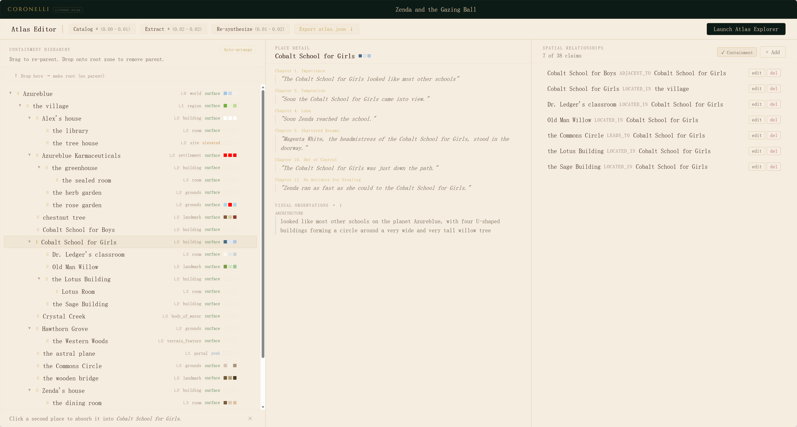
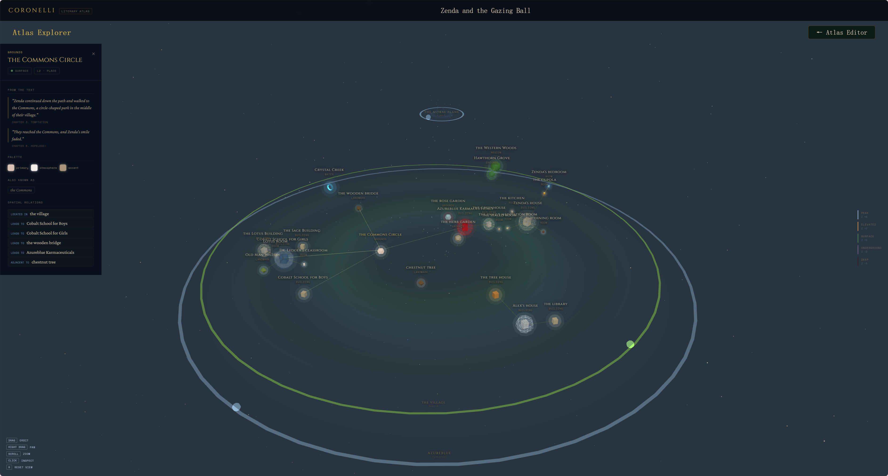

# Coronelli ◉

A tool for building literary atlases by hand.

Coronelli is inspired by the craft of historical cartographers. You read a book, work through it section by section, and decide what goes on the map — what places exist, how they relate, what they look like. The result is a navigable world you can orbit and inspect.





```
Upload → Catalog → Extract → Synthesize → Atlas Editor → 3D Explorer
```

- Import `.txt`, `.md`, and text-bearing `.pdf` files
- A pipeline surfaces candidate places, relationships, and descriptions as raw material
- You review every candidate — accepting, editing, or rejecting — before anything lands on the map
- Refine in the Atlas Editor: rename places, assign hierarchy, merge duplicates, add relationships
- Explore the finished atlas in a 3D scene: zone rings, floating nodes, force-directed layout

## Installation

Requires Python 3.12+. Install with [uv](https://docs.astral.sh/uv/):

```sh
uv tool install coronelli
```

Then launch:

```sh
coronelli
```

Coronelli opens in your browser at `http://localhost:8000`. Your atlas data is stored locally:

| Platform | Location |
|----------|----------|
| Windows  | `%LOCALAPPDATA%\Coronelli\coronelli.db` |
| macOS    | `~/Library/Application Support/Coronelli/coronelli.db` |
| Linux    | `~/.local/share/Coronelli/coronelli.db` |

Set your OpenAI API key before running extraction:

```sh
# in your shell profile, or in %LOCALAPPDATA%\Coronelli\.env  (Windows)
#                                ~/Library/Application Support/Coronelli/.env  (macOS)
OPENAI_API_KEY=sk-...
```

## Cost and caching

Each pipeline stage shows an estimated cost before you run it. Sections you have already processed are served from cache, so you only pay for new work.

## License

Source-available, personal non-commercial use only. See [LICENSE](LICENSE).
